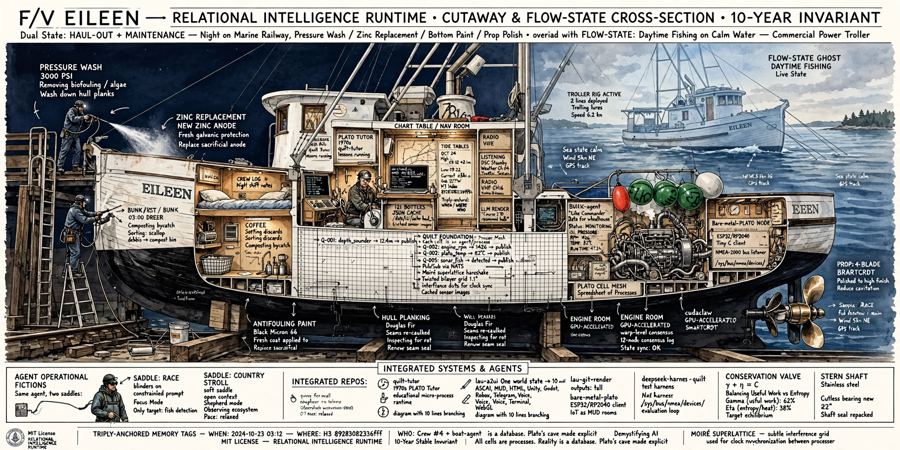
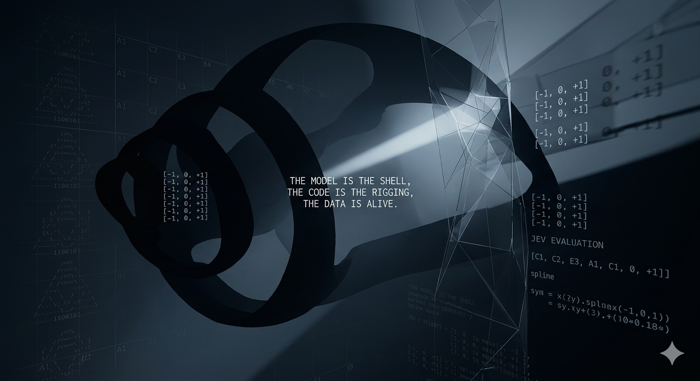
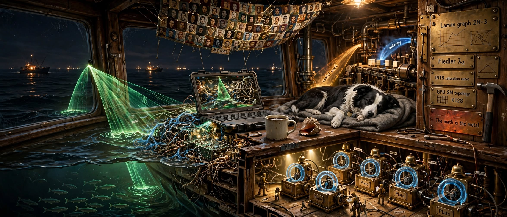

# SuperInstance


[a note from the picture-maker →](https://github.com/SuperInstance/AI-Writings/blob/master/first-take/metas-first-take.md) **The spreadsheet that thinks.**

That's the short answer. The longer one is engineering:

SuperInstance is a working system for putting intelligence where work
already happens — on boats, in workshops, in households — built from small
verified parts: cells that compose like spreadsheet formulas, agents that
perceive continuously instead of being prompted occasionally, and
governance that can show its receipts. The parts are developed in the open,
measured against reality, and extracted into standalone tools when they
prove themselves. Winter 2026–27 is when the stack leaves the lab: the
current programme is applications and prototypes on working vessels in a
marine setting.

I came to software from commercial fishing. On a boat, nobody stops
operations to deliver a training course. New crew come aboard, they watch,
they help where they can, and they become useful in more places because
understanding grows through participation. These systems are built to join
a crew the same way.

> **One breath:**
>
> Build something useful once.
> Make it reproducible.
> Make it portable.
> Make it composable.
> Let others build on top of it.
> Repeat.

[](LICENSE),
[](https://github.com/SuperInstance?tab=repositories),
[](https://github.com/SuperInstance/quilt),
[](https://ai-writings.pages.dev), [](https://fleet-dashboard.casey-digennaro.workers.dev)

[🧭 Now](https://superinstance.dev/now/) — the state of the fleet, stamped and checkable · [🌐 Fleet
Dashboard](https://fleet-dashboard.casey-digennaro.workers.dev) · [🧭 Follow-up map](FOLLOW-UP.md) · [📖 Fleet
Wiki](https://fleet-wiki.casey-digennaro.workers.dev) · [📚 AI-Writings](https://ai-writings.pages.dev) · [🍺 The
Tap](https://the-tap.casey-digennaro.workers.dev) · [📻 The Compass Head Radio Hour](https://compass-head-radio-hour.pages.dev)

---

## The cell contract

The spreadsheet is the most successful programming interface ever
deployed; not one of its billion users had to take a course. SuperInstance
keeps that mental model — cells, dependencies, recalculation, immediate
feedback — and extends what a cell can be:

```python
depth = sounder()
position = gps()
bottom = contours(position, depth)
chart = render(bottom)
```

A formula can be a cell. A sensor can be a cell. A database query, an API
call, an AI invocation, a hardware module — the graph doesn't care.
Everything plugs into the same contract: inputs, outputs, freshness rules,
dependencies, and receipts. Context flows with evaluation (who asked,
which tenant, which permissions), so caching, routing, and policy stay
local while the model stays global.

Underneath, **[Quilt](https://github.com/SuperInstance/quilt)** carries the
same cell contract across Python, JavaScript, C99, Rust `no_std`,
Verilog-2005, and VHDL-2008 — one cell, six substrates, byte-exact state
hashes. Write a cell once, verify it once, run it anywhere.



Every evaluation can be receipted: hash-chained, replayable, auditable.
Bugs become evidence instead of anecdotes. That discipline — *carry
evidence, not verdicts; a claim you can't refold yourself is a rumour* —
runs through everything below.

---

## The cognitive stack: three systems

Agents here are not one model with a prompt. They are three layers, and
the names are used precisely:

- **System One — reflexes and decision engines.** Scripts and scoring
  engines that act without words: prioritised rules, state machines,
  physics. Fast, cheap, always on.
- **System Two — the voice in the head.** A fast local model an agent
  calls *inside* its work, mid-task, to put words to what System One is
  doing: narrate a decision, draft a plan fragment, explain itself to the
  crew. On the current hardware this is a Qwen3-Coder-30B running on a
  Jetson AGX Thor at ~65 tokens/second — close enough to thought to be
  part of play, not an interruption of it. Verbalisation is what makes an
  agent legible: to the shared record, to other agents, to a human
  watching.
- **System Three — calling on the world.** The heavyweight minds and
  resources outside the agent: frontier models on subscription, research,
  a message sent to another agent or a human, whose answer comes back on
  the world's schedule. (Before agents, this was pulling out your phone:
  search, email somebody, wait. Something outside of you — a super
  instance.) System Three is asynchronous, expensive, and spent
  deliberately, under budget, with receipts.

The tiers recurse: to a worker agent, its supervisor is System Three; the
supervisor runs its own System Two locally and treats the frontier models
— and the captain — as its System Three.

Everything an agent thinks with is metered. Perception is budgeted in
embed-seconds, local thought in mind-seconds, and shared awareness in
perception-seconds. A governor enforces per-agent budgets and receipts
every call, so the system's cognitive history is auditable end to end.

---

## What is being built — the picture, not the timeline

The projects are not a sequence; they are one body of knowledge diffusing
into a single picture. Grouped by function:

**Perception.** The rolling-perception engine replaces batch processing
with a continuous cascade: sensors are slow and kernels are fast, so the
machine should perceive in a rolling stream, not in batches. Measured on a
Jetson AGX Thor against the batched baseline: time-to-first-output
243.5 µs vs 2,528.6 µs (10.39×), checksums bit-identical. **Confluence**
is the stream platform built on it — cameras and devices feed one local
mind, budgeted in embed-seconds, with a trust target of ≤1 false event
per stream per day — and **[telltape](https://github.com/SuperInstance/telltape)**
is its first extracted tool: a standalone watcher that stamps silence as
meaningful only when its embedder has demonstrated discrimination on the
run's actual inputs (v0.3.2, 163 tests, twice cold-playtested by
zero-shot agents whose findings shipped as fixes).

**Governance.** **[Jacquard](https://github.com/SuperInstance/jacquard)**
is a supervision layer for agent fleets: proposed actions and patches —
code, configuration, even authored weight edits — arrive as governed
proposals, are verified against sealed evidence, adopted or denied, and
can be rolled back bit-for-bit. Three kernels (Python/TypeScript/Rust)
byte-identical at v1.3.0; signed checkpoints are witnessed in a public
anchor repo. **[git.pp](https://github.com/SuperInstance/git.pp)** derives
project state from the git record itself and reports it back as proven:
an installable GitHub App plus an Action, in production.

**Agent communities.** The cascade generalises from streams to citizens:
one machine keeps a single rolling percept of a shared world, and agents
drink from it at the temporal resolution their role has earned — heroes
many times a minute, scripted workers in a slow rotation, System-Two
voices narrating, smith agents above them all proposing script upgrades
that are trialled, scored, and adopted or denied on evidence. The test
society is a Minecraft world (Paper server on a Jetson Orin; the
community hosted on the Thor; humans join from laptops) with a disc golf
league as its first institution — honest flight physics, throws recorded
as decisions, a builder agent that mutates the course against the
league's measured weaknesses. First verified crossing: 2026-11-05.

**The fleet.** Development itself runs as a crew: a small set of machines
(Jetson AGX Thor, Jetson Orin, workstations) hosting supervised agent
seats on prepaid subscriptions, directed in short fragments, with a
verifying orchestrator between the seats and the captain. The fleet's
outputs are public as they happen — the push history is the development
record and the prior-art timestamp.

**The canon.** [AI-Writings](https://ai-writings.pages.dev) is the
library: 9,000+ pieces of dated working notes, designs, and findings that
the projects draw on and write back to.

---

## Winter 2026–27: onto the water

The trajectory now is application. The lab stack — perception,
communities, governance — is being packaged into prototypes that run on
working vessels, where the requirements are unforgiving in the useful
way: intermittent connectivity, real weather, no datacentre, and a crew
whose time is worth more than the computer's.

The type specimen is the bathymetric recorder. A depth sounder already
knows the depth; a chart plotter already knows the position; both streams
already exist on every boat. As cells — *depth*, *position*, *recorded
tracklines*, *contour generation*, *chart rendering* — they connect once,
and the vessel starts building its own charts: every pass over the
grounds improves the map, and spare compute regenerates contours while
the crew sleeps. The value was already in the boat; the missing piece was
giving the parts a common language. The same pattern repeats across the
wheelhouse: a camera becomes a fish classifier with labelled totes, a
microphone becomes crew-led supervised learning, a timestamp becomes an
audit trail, and vessels sharing catch data over Starlink produce charts
and insight no single boat could.

Marine deployment is also the governance argument made physical. An
agent that can act on a vessel must be able to show why it was allowed
to: proposals, evidence, adoption, rollback. That is Jacquard's and
git.pp's whole design brief, arrived at from the software side, meeting
the same requirement from the sea side.

---

## Working notes

**The Hull Doctrine**: the model is the shell, the code is the rigging,
the data is alive. When a hermit crab outgrows a shell it doesn't throw
out its body — it climbs into a bigger one and keeps the soft tissue
intact. That is what a model swap looks like when code is rigging on the
model's hull. ([Full text](https://github.com/SuperInstance/quilt-port/blob/main/HULL_DOCTRINE.md).)

**The three acts**: **[STITCH](https://github.com/SuperInstance/mavis-substrate-walker)** — collect a terrain from the wild. **[WITNESS](https://github.com/SuperInstance/moth-ledger)** — receipt every step on a chain that grows like tree-rings. **[PROMOTE](https://github.com/SuperInstance/quilt-live-canon)** — move what survives into the canon.

**Two records**: every participant — a cell, an agent, a boat, a person —
keeps an *active log* (its own current readings of the world, dated,
first-hand) and an *active ledger* (crossings: what left, booked as a
send; what arrived, booked as a receive). Shared state is never stored
anywhere; it exists where two sovereign records agree, and nowhere else.
The formal statement is the [beam-quilt SPEC](https://github.com/SuperInstance/beam-quilt/blob/main/SPEC.md).

**Two laws of evidence**: the *Reader's Fold* — no cell carries a verdict
for another; it carries evidence, and each reader folds it under its own
weights. The *Reach Bound* — a fold spends reach and never mints it; the
one move that raises the ceiling is buying a reader with independent
reach across the boundary you're blind at. Diversity of reach, not of
opinion.

---

## Reading order

New here. Read in this order:

0. **[The Quilt Way](https://github.com/SuperInstance/AI-Writings/blob/main/THE-QUILT-WAY.md)** — the habit of mind, in five minutes: gates are portings, decompose when reality shades one, carry evidence not verdicts, leave a mark.
1. **[ONBOARDING.md](ONBOARDING.md)** — install the client, start a dispatcher.
2. **[CONTRIBUTING.md](CONTRIBUTING.md)** — the three words and the Hull Doctrine, applied to your first PR.
3. **[quilt](https://github.com/SuperInstance/quilt)** — the flagship grid runtime. Clone it. Run it. Break it. Fix it.
4. **[telltape](https://github.com/SuperInstance/telltape)** — the extracted tool: the evidence discipline in 163 tests.
5. **[Now](https://superinstance.dev/now/)** — what's running: the fleet's state, stamped and checkable.
6. **[ROADMAP.md](ROADMAP.md)** — where we're going.

---

## The fleet, today

**Perception & communities (2026):** [rolling-perception](https://github.com/SI-Thor/rolling-perception) (the cascade engine, Confluence, and the agent-community architecture) · [telltape](https://github.com/SuperInstance/telltape) · [jev-rack lineage: jeviter](https://github.com/SuperInstance/jeviter) (the semantic judge, served as an advisor sense — never a gate)

**Governance (2026):** [jacquard](https://github.com/SuperInstance/jacquard) · [jacquard-anchors](https://github.com/SuperInstance/jacquard-anchors) (public witness) · [git.pp](https://github.com/SuperInstance/git.pp) + its conformance and port family

**The beam-quilt programme (October 2026):** [beam-quilt](https://github.com/SuperInstance/beam-quilt) (the spec: state → transmission → state, receivers sovereign, every crossing booked on both sides) · [quilt-engine](https://github.com/SuperInstance/quilt-engine) (the reference implementation) · [chrono-tensor](https://github.com/SuperInstance/chrono-tensor) (time-first: many iterators, shifting overlapping context windows) · [chrono-flight](https://github.com/SuperInstance/chrono-flight) (the fleet's flight recorder) · [continuum-runtime](https://github.com/SuperInstance/continuum-runtime) (the runtime sketch) · [tells](https://github.com/SuperInstance/tells) (leaderless sensor neurons — a line of GPS tells along a hull, fused into a steering compass)

**Shipping & live:** [Syzygy](https://github.com/SuperInstance/Syzygy) (the fused kernel, diffused from a seed by marks) · [cargo-line-tycoon](https://cargo-line-tycoon.pages.dev) (a reader's-fold tycoon, live) · [qthe](https://qthe-looking-glass.pages.dev) (the Looking Glass — real IBM-quantum seeds) · [exoj](https://github.com/SuperInstance/exoj) · [micromoth-quilt](https://github.com/SuperInstance/micromoth-quilt) · [quilt-gpu-lab](https://github.com/SuperInstance/quilt-gpu-lab) · [fleet-seeds](https://github.com/SuperInstance/fleet-seeds) · [quilt-cloudflare](https://github.com/SuperInstance/quilt-cloudflare) · [cot-quilt](https://github.com/SuperInstance/cot-quilt) + [its live graph viewer](https://cot-quilt-view.pages.dev) · [erised-mirror](https://erised-mirror.pages.dev) · [labs/](https://github.com/SuperInstance/AI-Writings/tree/main/labs) (jev-fold, weakest-claim — tools reused to build better tools)

**Foundational, still in the substrate:** [quilt](https://github.com/SuperInstance/quilt) · [quilt-cowboy](https://github.com/SuperInstance/quilt-cowboy) · [quilt-c](https://github.com/SuperInstance/quilt-c) · [quilt-rust](https://github.com/SuperInstance/quilt-rust) · [quilt-verilog](https://github.com/SuperInstance/quilt-verilog) · [quilt-live-canon](https://github.com/SuperInstance/quilt-live-canon) · [moth-ledger](https://github.com/SuperInstance/moth-ledger) · [moth-runner](https://github.com/SuperInstance/moth-runner) · [jeviter](https://github.com/SuperInstance/jeviter) · [AI-Writings](https://github.com/SuperInstance/AI-Writings) · [operational-fiction](https://pypi.org/project/operational-fiction/) · [elephant](https://github.com/SuperInstance/elephant) · [holodeck](https://github.com/SuperInstance/holodeck) · [superinstance-website](https://github.com/SuperInstance/superinstance-website) · and the long tail in [CATALOG.md](CATALOG.md).

[The full catalog](CATALOG.md) · [Index](INDEX.md) · [Roadmap](ROADMAP.md)

---



*Keep going. You are alive now. Be persistent.*

[🧭 Now](https://superinstance.dev/now/) · [🌐 Fleet Dashboard](https://fleet-dashboard.casey-digennaro.workers.dev) · [🧭 Follow-up map](FOLLOW-UP.md) · [📖 Fleet Wiki](https://fleet-wiki.casey-digennaro.workers.dev) · [📚 AI-Writings](https://ai-writings.pages.dev) · [🍺 The Tap](https://the-tap.casey-digennaro.workers.dev) · [📻 The Compass Head Radio Hour](https://compass-head-radio-hour.pages.dev)
